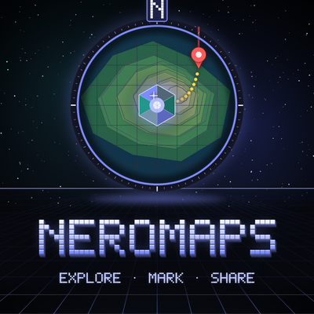

# NeroMaps



**NeroMaps** is the minimap and world map of the Neroland mod family: a performant, highly customisable
minimap that is on by default, a world map, waypoints you can share by consent, and the features of the other
Nero mods drawn on the map.

> **Status: 0.1.0-beta.3.** Minimap and world map, waypoints, consent-only sharing, fog of war, the survival
> cartography blocks, map layers from the other Nero mods and the `neromaps` NeroLink module. See the
> [CHANGELOG](CHANGELOG.md) for what shipped, what was cut and what is deferred, and the
> [wiki](https://github.com/Neroland/neromaps/wiki) for how to use it.

## Requirements

- Minecraft 26.3 (also built for 26.2, 26.1.2 and 1.21.1 / 1.21.4 / 1.21.5 / 1.21.7-1.21.8 / 1.21.9-1.21.10 /
  1.21.11)
- Fabric (with Fabric API), NeoForge or Forge
- Minecraft 1.20.5 on Fabric, and 1.20.6 on Fabric, Forge and NeoForge
- [Neroland Core](https://github.com/Neroland/neroland-core) 1.23.0 or newer (below 2.0)

NeroMaps depends on Neroland Core and nothing else.

## Privacy

Where you are is personal data. NeroMaps never writes a player's position to disk and never shows another
player where you are, have been or have built without your consent or the server's stated policy. See
[PRIVACY.md](PRIVACY.md).

## Building

```text
./gradlew :neoforge:26.3:build :fabric:26.3:build :forge:26.3:build
./gradlew :fabric:26.3:ecjCheck
```

Build each cell explicitly (`:<loader>:<minecraft>:build`); a plain `build` is not supported. Neroland Core is
resolved from `mavenLocal()` or GitHub Packages, see [USING-CORE.md](USING-CORE.md).

## License

All Rights Reserved; modpacks allowed. See [LICENSE](LICENSE).
